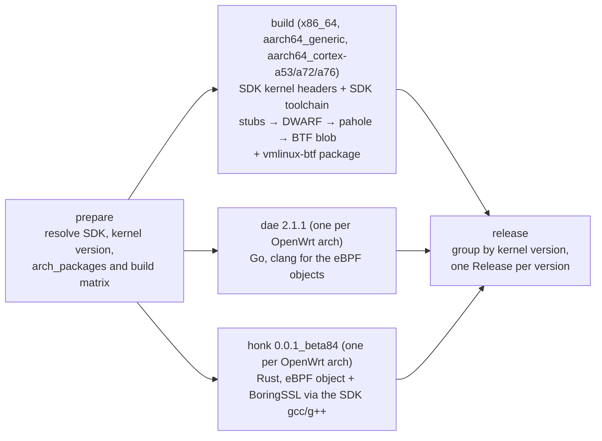

# vmlinux-bpf-build

Builds a BTF-enabled `vmlinux` for OpenWrt targets and builds the `vmlinux-btf`,
`dae` and `honk` packages for the same architectures, then publishes everything
in a single GitHub Release per kernel version.

The BTF is produced the way the OpenWrt package
[QiuSimons/vmlinux-btf](https://github.com/QiuSimons/vmlinux-btf) does it: a few
small stub sources (`src/shadow_btf_*.c`, vendored from that repository) include
the key kernel headers, the target compiler emits their DWARF, and `pahole`
converts that into the detached BTF blob. Everything comes from the **official
OpenWrt SDK** of each target — its prepared kernel headers and its cross
toolchain — so neither an OpenWrt buildroot nor a kernel configuration or build
is involved, and the types are exactly those of the kernel OpenWrt ships for
that target, patches included.

The packages around it are ordinary OpenWrt packages: the repository root
doubles as an [OpenWrt feed](#repository-layout), with `vmlinux-btf/`, `dae/` and
`honk/` next to the BTF sources, so the released assets are real `.apk` packages
that can be installed with `apk add`.

Everything happens in a single workflow,
[`.github/workflows/build-vmlinux-btf.yml`](.github/workflows/build-vmlinux-btf.yml),
which is documented below. See [Provenance](#provenance) for where each part
comes from.

---

## Repository layout

```
.
├── .github/workflows/build-vmlinux-btf.yml  # the only workflow
├── vmlinux-btf/  # OpenWrt package "vmlinux-btf": Makefile (prebuilt blob)
├── dae/          # OpenWrt package "dae":  Makefile + build.sh  (sources in dae/src)
├── honk/         # OpenWrt package "honk": Makefile + build.sh  (sources in honk/src)
└── src/          # vendored BTF stubs from QiuSimons/vmlinux-btf
```

The repository root is an OpenWrt feed. The workflow writes
`src-link local <workspace>` into the SDK's `feeds.conf`, installs the packages
from it and builds them with `make package/<name>/compile`, which is what turns
them into `.apk` packages. `vmlinux-btf` is special: the workflow hands the BTF
blob it just produced to the package as `VMLINUX_BTF_SRC`, so the package only
installs it and the archive and the package hold identical bytes.
The upstream sources are checked out into `dae/src` and `honk/src` (they are not
committed), so the directories can also be copied into an OpenWrt buildroot,
or used against a manually unpacked SDK:

```sh
git clone --recurse-submodules --branch v2.1.1 https://github.com/daeuniverse/dae dae/src
git clone --branch v0.0.1.beta.84 https://github.com/daeuniverse/honk honk/src
```

## What it produces

| Asset | Contents | Built from |
|---|---|---|
| `<openwrt_version>-vmlinux-<openwrt_arch>-<kernel_version>.tar.xz` | one file named `vmlinux`: the detached BTF blob (the same file the upstream package installs) | `src/shadow_btf_*.c` compiled against the SDK's prepared kernel headers with the SDK toolchain, then `pahole` |
| `<openwrt_version>-vmlinux-btf-<openwrt_arch>-<kernel_version>.apk` | OpenWrt package `vmlinux-btf` (version = kernel version), installing `/usr/lib/debug/boot/vmlinux` and the `vmlinux-<kernel release>` symlink next to it | the same blob, packaged with [`vmlinux-btf/Makefile`](vmlinux-btf/Makefile) |
| `<openwrt_version>-dae-2.1.1-<openwrt_arch>.apk` | OpenWrt package `dae` 2.1.1, installing `/usr/bin/dae` | [daeuniverse/dae](https://github.com/daeuniverse/dae) tag `v2.1.1`, built by [`dae/Makefile`](dae/Makefile) |
| `<openwrt_version>-honk-0.0.1_beta84-<openwrt_arch>.apk` | OpenWrt package `honk` 0.0.1_beta84, installing `/usr/bin/honk-core` | [daeuniverse/honk](https://github.com/daeuniverse/honk) tag `v0.0.1.beta.84`, built by [`honk/Makefile`](honk/Makefile) |

Every asset is uploaded together with its `.sha256` checksum. The `dae` and
`honk` packages are built once per OpenWrt architecture and are pinned to an
upstream release, so their name carries that version and not the kernel version;
`x86_64` gets `25.12.5-dae-2.1.1-x86_64.apk` while `aarch64_cortex-a76` gets
`25.12.5-honk-0.0.1_beta84-aarch64_cortex-a76.apk`. OpenWrt 25.x produces
`.apk` packages; for older releases (24.10 and earlier) the same step produces
`.ipk` and the asset keeps that extension.

The version also flows into the binaries: it is passed to the package Makefiles
as `DAE_VERSION` / `HONK_VERSION`, dae's own make receives it as `VERSION`, and
honk derives the string it embeds from `GITHUB_REF`, so a
`refs/tags/v0.0.1.beta.84` ref is exported for its build (the build script then
asserts that the tag, not the git fallback, is what ended up in the binary).
`0.0.1~beta.84` is not a valid apk version — `~` there introduces a commit hash
— so the package spells the beta pre-release as `_beta84`, while the sources
and the embedded version come from the upstream tag `v0.0.1.beta.84` itself.

## Usage

1. Go to **Actions → Build vmlinux (BTF) → Run workflow**.
2. Fill in the inputs:

| Input | Default | Meaning |
|---|---|---|
| `openwrt_version` | `25.12.5` | OpenWrt release to build for, e.g. `25.12.5` or `24.10.8`. The kernel version is taken from that release, not entered by hand. |

The kernel version comes from the chosen OpenWrt release, so `openwrt_version`
is the only input (there is no choice between a BTF blob and a full `vmlinux`
ELF any more).

3. The result appears under **Releases**, tagged
   `openwrt-<openwrt_version>-<kernel_version>` — for example
   `openwrt-25.12.5-6.12.94`. All architectures of one kernel version are
   collected in that single release; re-running the workflow overwrites the
   existing assets instead of failing, and an existing tag/release is reused.
   The `dae`/`honk` assets are kernel independent, so every release published by
   a run carries the same set of them (all five architectures), while each
   `vmlinux-btf` package sits in the release of its kernel version.

On a device, the BTF blob is normally installed where libbpf and `bpftool`
expect it, `/usr/lib/debug/boot/vmlinux`. The `vmlinux-btf` package does exactly
that (including the `vmlinux-<kernel release>` symlink the upstream package
creates), so the archive can be skipped entirely:

```sh
apk add --allow-untrusted 25.12.5-vmlinux-btf-aarch64_cortex-a76-6.12.94.apk
# OpenWrt 24.10 and older: opkg install 24.10.8-vmlinux-btf-aarch64_cortex-a76-6.12.94.ipk
```

The `dae` and `honk` assets are OpenWrt packages as well:

```sh
apk add --allow-untrusted 25.12.5-dae-2.1.1-aarch64_cortex-a76.apk
apk add --allow-untrusted 25.12.5-honk-0.0.1_beta84-aarch64_cortex-a76.apk
```

The packages are unsigned (they are built without a signing key), hence
`--allow-untrusted`; verify the `.sha256` checksum first if you prefer. The
userspace packages install `/usr/bin/dae` and `/usr/bin/honk-core`; `honk`
declares `libstdcpp` as a dependency, so `apk` pulls it in automatically.

## Architectures

One representative target/subtarget per OpenWrt architecture (`arch_packages`):

| OpenWrt arch | target/subtarget | kernel arch |
|---|---|---|
| `x86_64` | `x86/64` | x86_64 |
| `aarch64_generic` | `armsr/armv8` | arm64 |
| `aarch64_cortex-a53` | `mediatek/filogic` | arm64 |
| `aarch64_cortex-a72` | `bcm27xx/bcm2711` | arm64 |
| `aarch64_cortex-a76` | `bcm27xx/bcm2712` | arm64 |

Several targets share the same `arch_packages` (for `aarch64_cortex-a53` also
`qualcommax/ipq807x`, `sunxi/cortexa53`, `mvebu/cortexa53`, …), so the list picks
one each. If a device needs a different kernel `.config`, replace the row with
another target/subtarget that reports the same `arch_packages` — the workflow
verifies `arch_packages` against `profiles.json` and fails fast if it does not
match.

The packages are built for every row of that table, one job per architecture,
using the SDK of that architecture (the same matrix drives the kernel, the BTF
package and the userspace builds). `vmlinux-btf` only wraps the blob that the
`build` job produced for that architecture. `dae` is plain Go, so it only needs
`GOOS=linux` plus the right `GOARCH`/`GOAMD64`/`GOARM64`, and it is tuned per
architecture: `amd64` for `x86_64`, `arm64` with `GOARM64=v8.0` for the generic
and Cortex-A53/A72 targets, and `GOARM64=v8.2,lse` for `aarch64_cortex-a76`
(the A76 implements ARMv8.2 with LSE atomics, which lets Go emit atomic
instructions instead of LL/SC loops). `honk` uses the target's own OpenWrt
toolchain, so each architecture gets a binary built against its own musl and
instruction set.

## How it works



**prepare** — reads
`releases/<version>/targets/<target>/<subtarget>/profiles.json` for
`arch_packages` (validated) and `linux_kernel.version`, and finds the SDK archive
of each target in the download index.

**build** (one job per architecture, does not depend on the other jobs) —
downloads and extracts the SDK, then takes from it:

* the kernel tree OpenWrt already prepared (`build_dir/*/linux-*/linux-*/`, with
  `include/generated/autoconf.h` for that target's `.config`, the generated
  include trees and `Module.symvers`); the `.c` files are stripped from the SDK,
  which does not matter because only headers are included,
* the cross toolchain (`staging_dir/toolchain-*/bin/*-openwrt-linux-musl-gcc`),
  used as an absolute `CROSS_COMPILE` and put on `PATH`,
* `STAGING_DIR` / `STAGING_DIR_HOST`, which the OpenWrt toolchain needs to find
  its sysroot (the values follow OpenWrt's `rules.mk`).

It compiles `src/shadow_btf_core.c` and the two optional units with the upstream
`BTF_CFLAGS` option set (`-nostdinc`, `-isystem` of the compiler's own include
dir, `-D__KERNEL__`, the kernel include trees, `-fshort-wchar`, `-g -gdwarf-4`,
`-fno-eliminate-unused-debug-types`, …), links them with `ld -r` and runs
`pahole --btf_encode_detached` (falling back to `pahole -J` plus
`objcopy --dump-section .BTF` on pahole versions without detached encoding). It
then checks the blob's BTF header (magic `0xeb9f`, non-empty type section) and
that `pahole -C sk_buff` finds the struct, which is the same smoke test the
upstream Makefile runs. Nothing is downloaded from kernel.org and no kernel is
configured or compiled. The same blob is then handed to
[`vmlinux-btf/Makefile`](vmlinux-btf/Makefile) as `VMLINUX_BTF_SRC` and the SDK
packages it, with the kernel version as the package version; the symlink name is
`UTS_RELEASE` from the SDK's `include/generated/utsrelease.h` (the SDK does not
keep `include/config/kernel.release`), so it matches `uname -r` on the device.

**dae** — [`dae/Makefile`](dae/Makefile) is an ordinary OpenWrt package whose
`Build/Compile` calls [`dae/build.sh`](dae/build.sh); the job checks out the
`v2.1.1` tag and only installs the Go toolchain (`actions/setup-go`, using the
version from `dae/src/go.mod`) and clang, which compiles the eBPF objects that
`bpf2go` embeds. The submodules holding the eBPF headers are checked out with
the sources. The build script maps
`arch_packages` to `GOARCH`/`GOAMD64`/`GOARM64` (`amd64` with `v1` for x86_64,
`arm64` with `v8.0`, or `v8.2,lse` on Cortex-A76) and runs dae's own Makefile;
that Makefile unsets the cross-compile variables around `go generate` only, so
the host side still generates the eBPF objects (`GOARM64` needs Go 1.23 or
newer). It then asserts that the result really is a binary for the target and
that it needs no shared library at all.

**honk** — [`honk/Makefile`](honk/Makefile) and [`honk/build.sh`](honk/build.sh)
do the same for honk, whose sources are checked out from the `v0.0.1.beta.84`
tag: the job installs the two toolchains pinned in honk's `rust-toolchain.toml`
files (stable for honk-core, a nightly with `rust-src` for the eBPF object) plus
the pinned `bpf-linker` from `.github/ci/pins.env`, and the SDK's package build
does the rest. The build script writes small `gcc`/`g++`
wrappers that drop the clang-style `--target=` flags CMake injects into
`boring-sys` compile rules (upstream's `ci/zigcc` trick, with the OpenWrt
compiler as the real compiler), builds the eBPF object, checks its `.BTF`
section, and builds `honk-core` with `-C link-self-contained=no -C
target-feature=-crt-static` so it links against the SDK's musl instead of the
musl bundled with Rust (the toolchain has no static unwind library, so
everything is dynamic — the package declares `libstdcpp` as its dependency). It
finally rejects a GLIBC interpreter, `libsystemd` and any unexpected shared
library, and asserts that the version embedded by honk's build script is the
release tag `v0.0.1.beta.84` (the package itself is versioned `0.0.1_beta84`,
which is how apk spells that pre-release).

**release** — collects the artifacts, groups the kernel assets by kernel version,
and for each group checks whether the tag/release already exists
(`gh release view` and `gh api .../git/ref/tags/...`) before creating it, then
uploads all assets with `--clobber`. The `vmlinux-btf` packages are grouped like
the archives; the `dae`/`honk` assets are added to every group, since they do
not belong to one kernel version. Creating the tag is done with `gh`, pointing
it at the commit the workflow ran on.

## Provenance

Everything in this repository is derived from other projects; the table below
records where each piece comes from and what was taken from it.

| Source | Taken from it |
|---|---|
| [QiuSimons/vmlinux-btf](https://github.com/QiuSimons/vmlinux-btf) (OpenWrt package, GPL-3.0) | The whole approach and the code behind it: `src/shadow_btf_{core,modules,private}.c` are vendored verbatim (upstream commit `4585b7c`), including the `BTF_KEEP` trick that keeps the interesting structs reachable, and the `BTF_CFLAGS` set and the pahole invocation (detached encode, the `-J` + `objcopy` fallback, the `pahole -C sk_buff` smoke test) follow its `Makefile`. Only the environment differs: upstream runs inside the OpenWrt buildroot or its SDK container, while this workflow rebuilds `$(LINUX_DIR)`, `TARGET_CC_NOCACHE` and `STAGING_DIR` from the SDK tarball. [`vmlinux-btf/Makefile`](vmlinux-btf/Makefile) follows the install layout of its package: `/usr/lib/debug/boot/vmlinux` plus the `vmlinux-<kernel release>` symlink, with `LINUX_VERSION` (here `VMLINUX_BTF_VERSION`) as the version, except that the blob arrives prebuilt instead of being compiled inside the package. |
| [openwrt/openwrt](https://github.com/openwrt/openwrt) (GPL-2.0) | The prebuilt SDKs (toolchain, the prepared kernel header tree, `staging_dir` layout), the `STAGING_DIR` / `STAGING_DIR_HOST` semantics from `rules.mk`, and the target metadata (`profiles.json`: `arch_packages`, `linux_kernel.version`). |
| [daeuniverse/dae](https://github.com/daeuniverse/dae) (AGPL-3.0) | The sources at tag `v2.1.1`, built with its own `Makefile` and its `dae_bpf_headers` submodules. The cross-compile recipe (`CGO_ENABLED=0`, clang for `bpf2go`, `GOOS=linux`) follows its release workflow; the Makefile itself unsets `GOOS`/`GOARCH` around `go generate` so the eBPF generation runs on the host. Its release tags are where the package version (`2.1.1`, the tag without its leading `v`) comes from. |
| [daeuniverse/honk](https://github.com/daeuniverse/honk) (GPL-3.0) | The sources at tag `v0.0.1.beta.84` and the build recipe from its release workflow: pinned toolchains from the `rust-toolchain.toml` files, the eBPF object built once with `-Zbuild-std=core --target bpfel-unknown-none` plus the BTF assertion, `bpf-linker` pinned through `.github/ci/pins.env`, the default feature set (`clash-api`, `mimalloc`, `rprx`, `ebpf`), the zig wrapper trick from `ci/zigcc`/`ci/zigcxx`/`ci/zig-bindgen-env` and the CMake/bindgen handling it exists for — re-implemented here against the OpenWrt `gcc`/`g++` instead of zig, because the SDK already provides a compiler for the target and its libc. Its release tags are where the version comes from: the binary embeds `v0.0.1.beta.84`, the package is versioned `0.0.1_beta84` because apk reserves `~` for a commit hash. |
| [aya-rs/bpf-linker](https://github.com/aya-rs/bpf-linker) | The prebuilt `bpf-linker` binary (version and SHA256 come from honk's `pins.env`). |
| GitHub Actions | `actions/checkout`, `actions/setup-go`, `actions/upload-artifact`, `actions/download-artifact`, `dtolnay/rust-toolchain`. |

The upstream sources are checked out by the workflow (their commits are in the
job logs), the packages are pinned to the upstream releases above, and the
`dae`/`honk` packages install the upstream license text under
`/usr/share/licenses/<name>/LICENSE`.

## Notes and limitations

* **BTF fidelity.** The stubs are compiled against the kernel tree the SDK ships
  for that target, so the types come from OpenWrt's own kernel sources *with its
  patches applied* and from the target's own `autoconf.h`, i.e. from what the
  device runs. No upstream kernel source is involved, so the earlier caveat
  about patched struct layouts no longer applies.
* **Coverage.** The blob contains the types the stubs reach: the core unit
  (task/socket/skbuff/netdevice/bpf/…), plus netfilter, routing, qdisc, XDP
  socket and a few private structs when the target config and headers allow it.
  A program that needs a type nobody includes will not find it — extend the
  stubs (and keep them in sync with upstream) if that happens.
* **One subtarget per architecture** is built (see above); the prepared kernel
  tree of that subtarget is the one used.
* **`pahole` comes from the runner** (`dwarves` on Ubuntu 24.04). The workflow
  prefers `--btf_encode_detached` and falls back to `-J` + `objcopy` when the
  installed pahole is too old for it.
* **honk** is linked dynamically against the SDK's musl, so the package depends
  on `libstdcpp` and `apk`/`opkg` pull it in. The build fails if the binary asks
  for a GLIBC loader, for `libsystemd` or for any shared library besides libc,
  libgcc_s and libstdc++. If the Rust LTO link ever trips the linker plugin of
  GNU `ld`, set `CARGO_PROFILE_RELEASE_LTO=false` for that build.
* **dae** is a static Go binary with no libc dependency at all, one package per
  architecture, version `2.1.1`.
* **The userspace packages are pinned**, so a re-run over the same OpenWrt
  version produces the same asset names: `dae` 2.1.1 and `honk` 0.0.1_beta84 are
  fixed until the versions in the prepare job are bumped. The tag/release they
  are attached to is still the kernel based
  `openwrt-<version>-<kernel_version>`.
* **The packages are unsigned**: they are built without a signing key, so
  installing them needs `apk add --allow-untrusted <file>` (or
  `opkg install <file>`, which does not verify signatures by default). Sign them
  yourself with `apk` if you redistribute them.
* **Time and cost.** Each of the five BTF jobs takes a few minutes, and each dae
  and honk job downloads the ~250 MB SDK plus its language toolchain. They all
  run in parallel, so on plans with a low limit of concurrent jobs the runs will
  queue — trim the target list to what you need.
* **A failing userspace build does not block the release** — the kernel assets
  are published anyway and the missing `dae`/`honk` assets are simply absent
  from that release. `vmlinux-btf` is built in the kernel job itself, so a
  packaging failure fails that architecture's job and the release is not
  published.

## Licensing

This repository contains the workflow, the three OpenWrt packages
(`vmlinux-btf/`, `dae/`, `honk/`), the vendored stubs under `src/` and this
README. The stubs are a verbatim copy of GPL-3.0-or-later code
from [QiuSimons/vmlinux-btf](https://github.com/QiuSimons/vmlinux-btf), and the
rest is derived from the projects below, so adding a `LICENSE` file (GPL-3.0) is
recommended and effectively required for redistribution.

The published artifacts redistribute third-party software, so the licenses of the
sources apply: the BTF describes an OpenWrt (GPL-2.0) kernel and declares
`GPL-2.0-only`, `dae` is **AGPL-3.0** and `honk` is GPL-3.0. The `dae` and
`honk` packages install the upstream license text, which is what GPL/AGPL
redistribution requires; keep that file with the package if you mirror it
elsewhere.
